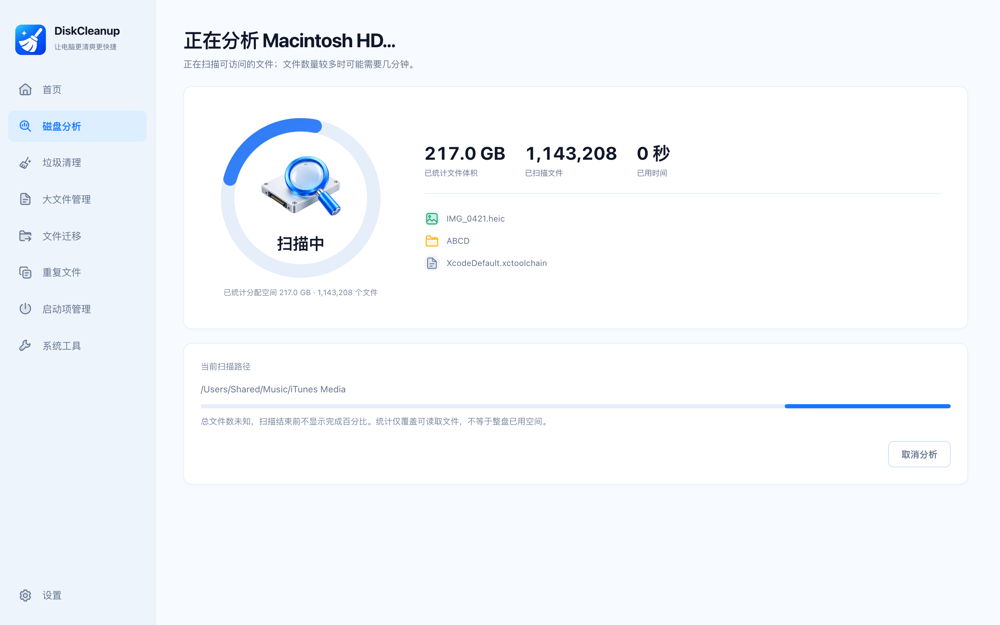
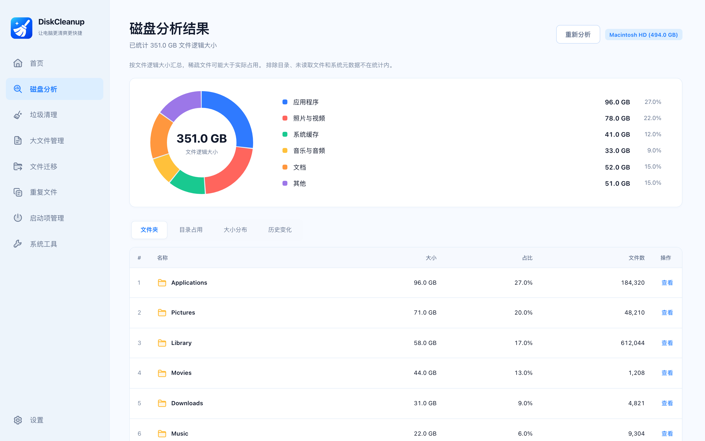
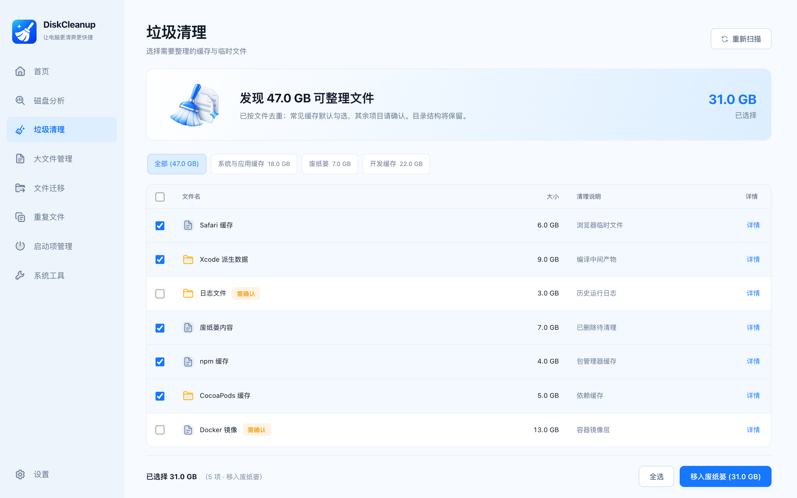
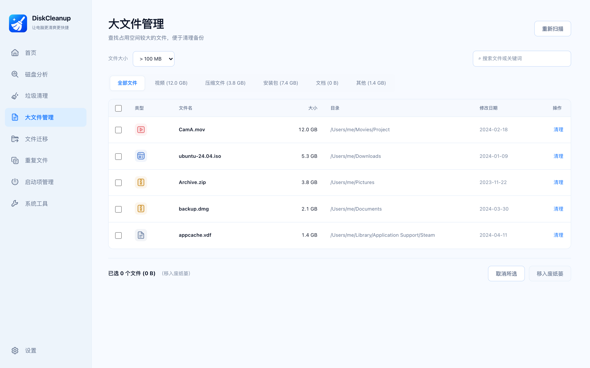
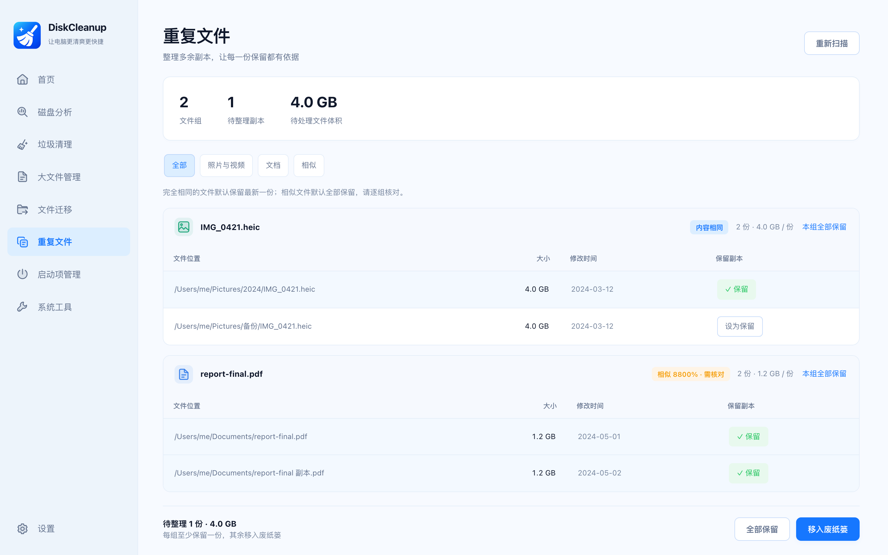
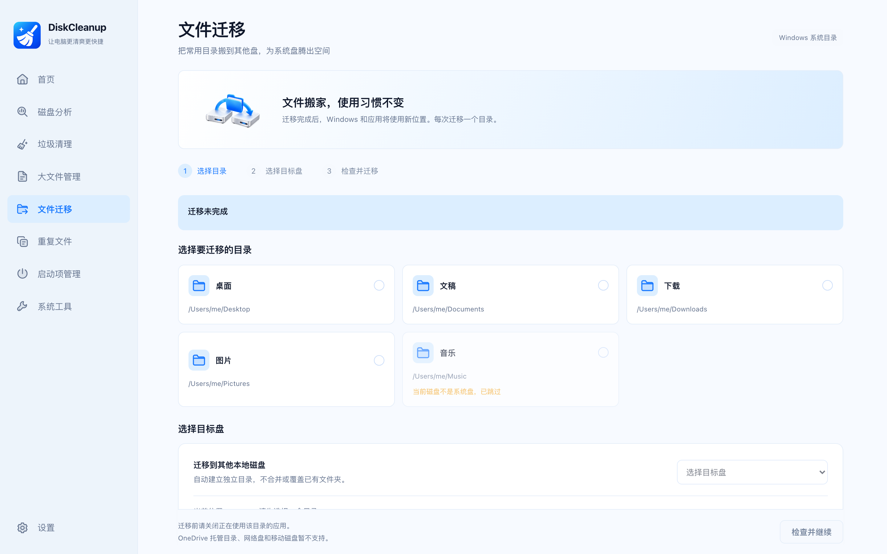
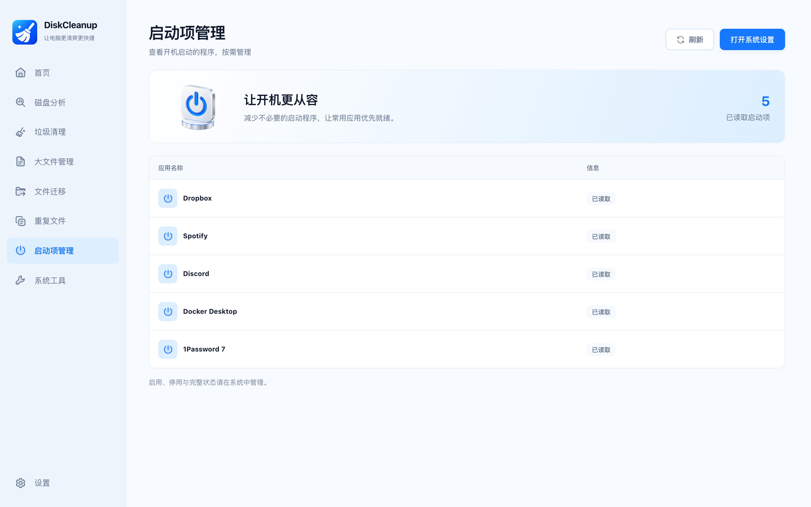
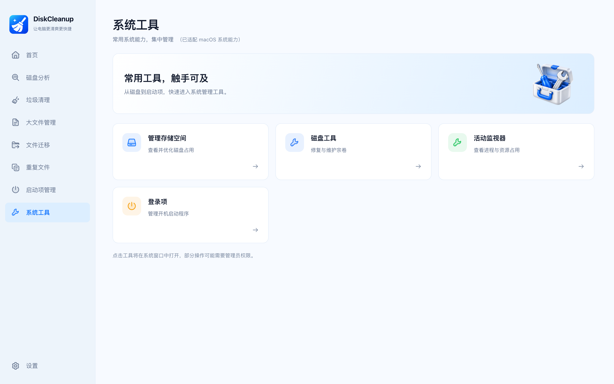
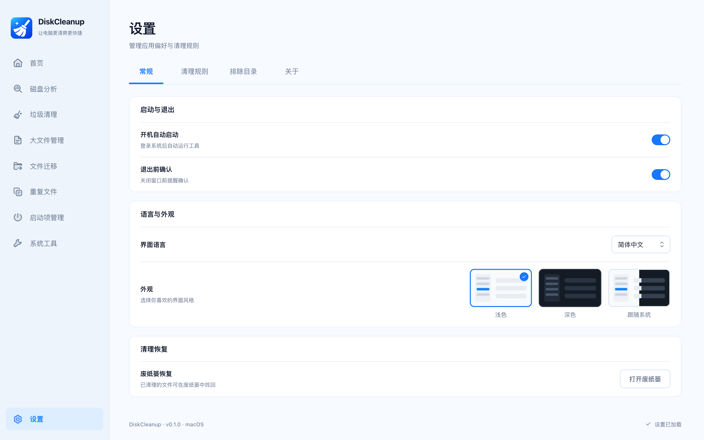

<p align="center">
  
</p>

<h1 align="center">DiskCleanup ｜ 磁盘清理助手</h1>

<p align="center">跨平台（macOS / Windows）磁盘分析与清理工具</p>

<p align="center">
  <a href="https://github.com/HuiTurn/DiskCleanup/actions/workflows/ci.yml"></a>
  <a href="./LICENSE"></a>
  
  
</p>

<p align="center">
  <a href="./README.en.md">English</a> | 简体中文
</p>

扫描磁盘占用、定位大文件与重复文件、按平台规则清理垃圾。所有删除操作统一移入系统废纸篓 / 回收站，误删可恢复。

基于 **Tauri 2 + React 18 + TypeScript + Zustand**，Rust 引擎负责扫描、清理与定时调度。

## 界面预览

| [](docs/screenshots/home.png)<br>首页 | [](docs/screenshots/analyze.png)<br>磁盘分析 |
|---|---|

<details>
<summary><b>展开其余 9 个界面</b></summary>

| [](docs/screenshots/results.png)<br>分析结果 | [](docs/screenshots/junk.png)<br>垃圾清理 |
|---|---|
| [](docs/screenshots/large-files.png)<br>大文件管理 | [](docs/screenshots/duplicates.png)<br>重复文件 |
| [](docs/screenshots/file-migration.png)<br>文件迁移 | [](docs/screenshots/launch-items.png)<br>启动项管理 |
| [](docs/screenshots/system-tools.png)<br>系统工具 | [](docs/screenshots/done.png)<br>清理完成 |
| [](docs/screenshots/settings.png)<br>设置 | |

</details>

> 截图由 CI 在 mock 数据模式下自动渲染（`scripts/screenshot.mjs`），每次 push 的最新版本可从 Actions artifact 获取；本地执行 `node scripts/screenshot.mjs` 可重新生成到 `docs/screenshots/`。

## 功能特性

### 磁盘分析

- **首页**：系统盘用量概览、开始磁盘分析、4 个常用功能入口。
- **扫描引擎**：Rust 后台线程遍历，实时推送进度环与文件流，支持随时取消。
- **结果四视图**：Top 文件夹 / 同名目录合并统计 / 6 档大小分布直方图 / 历史扫描趋势与环比增减。
- 支持目录下钻与扫描排除目录。

### 清理

- **垃圾清理**：按平台规则集扫描（macOS 缓存 / 日志 / 开发缓存…，Windows 临时文件 / 更新缓存…），勾选后一键清理。
- **大文件管理**：10MB–1GB 阈值筛选、关键词搜索、批量清理。
- **重复文件**：体积预筛 → 头部哈希 → 全量哈希；相似文件按文件名归一化（`photo.jpg` / `photo 副本.jpg` / `photo (1).jpg`）+ 体积 ±40% + 4KB 片段重合度综合评分，与「完全相同」（SHA-256）分列展示。
- **清理完成**：空间 / 文件数 / 耗时统计与恢复说明。

### 文件与系统

- **文件迁移（Windows）**：将桌面、文档、下载、图片、音乐、视频重定向到其他本地磁盘，并更新系统目录位置。
- **启动项管理**：读取 macOS 登录项（Login Items）与 Windows Run 注册表。
- **系统工具**：按平台动态生成工具宫格，Windows 专属项映射为 macOS 等价功能。

### 自动化与体验

- **自动清理**：macOS 注册 launchd LaunchAgent（`~/Library/LaunchAgents/cn.aipalnet.diskcleanup.autoclean.plist`），Windows 注册计划任务 `DiskCleanupAutoClean`；两者以 `diskcleanup --auto-clean` 无头执行，只清理标记为 safe 的缓存项并记录 `lastAutoCleanTs`。设置页支持「立即执行」。
- **退出前确认**：拦截 `CloseRequested`，前端二次确认后才关闭（可在设置中关闭）。
- **个性化**：开机自启、扫描排除目录、大文件阈值、自动清理、深色主题。

### 文件迁移（Windows）

入口位于侧边栏「大文件管理」下方。选择系统目录与目标盘 → 「检查并继续」→ 确认完整路径、文件数量与空间占用 → 开始迁移。

- 通过 Windows Known Folder Manager 的 `Redirect` 接口复制内容、删除已复制的源内容并更新系统目录位置，目标为 `<目标盘>\Users\<用户目录名>\<系统目录名>`。
- 每次只迁移一个目录；拒绝同卷、目标已存在、嵌套系统目录、OneDrive 托管、重解析点、离线占位文件、EFS 加密文件，以及无法完整读取的目录。
- 仅支持本地固定磁盘；开始前复核真实目录位置与空间，额外预留至少 256MB 或 5%。
- 迁移期间由 Windows 显示复制界面，应用禁止正常退出。失败、取消或进程异常退出可能留下部分文件，应用不自动回滚，需按 `%LOCALAPPDATA%\diskcleanup\migrations` 中的计划与结果核对。
- macOS 仅显示平台说明，不执行目录重定向。

## 安全设计

- 所有删除统一走系统废纸篓 / 回收站（`trash` crate），不直接删除文件。
- 每次清理写入 `cleanup_log.json`：Windows / Linux 可通过 `trash::os_limited::restore_all` 程序化恢复；macOS 受系统限制，降级为「打开废纸篓 + 指引放回原处」。
- 自动清理只处理安全规则命中的缓存项，不触碰用户文档。

## 下载与安装

前往 [Releases](https://github.com/HuiTurn/DiskCleanup/releases) 下载最新版本：

- macOS（Apple Silicon / Intel）：通用 DMG，拖入「应用程序」即可
- Windows x64：NSIS 安装包
- 校验和：`SHA256SUMS.txt`

所有安装包均未做代码签名，首次打开需手动放行：

- macOS 若提示「已损坏，无法打开」，执行 `xattr -cr /Applications/DiskCleanup.app` 后重新打开。
- Windows SmartScreen 提示时，选择「更多信息 → 仍要运行」。

也可以从源码构建（见下文）。

## 开发

环境要求：

- Node.js 18+（CI 使用 20 / 22）
- Rust stable
- macOS：Xcode Command Line Tools
- Windows：MSVC Build Tools + WebView2 Runtime（Windows 11 自带）

```bash
npm install
npm run tauri dev     # 开发模式（自动启动 Vite + 原生窗口）
npm run tauri build   # 生产构建（macOS .app / Windows NSIS .exe）
```

测试：

```bash
npm test                            # 前端单测（node --test）
cd src-tauri && cargo test --lib    # Rust 引擎单测
```

Rust 单测覆盖目录体积统计、大文件筛选排序、完全相同与相似文件识别、垃圾规则统计、设置持久化往返与排除目录生效；前端单测覆盖分析结果聚合、重复文件保留策略与扫描缓存。

CI 配置：

- `.github/workflows/ci.yml`：Ubuntu / Windows / macOS 三平台运行前端测试与构建，三平台运行 Rust 单测，并在 mock 模式下自动刷新截图。
- `.github/workflows/validation.yml`：macOS / Windows 上执行双端测试、构建与 `cargo check`。

## 项目状态与已知限制

- 版本 `0.1.0`，界面与数据结构可能调整；已提供未签名安装包。
- Windows 文件迁移引擎已通过目标平台的独立 Rust 类型检查，但当前开发环境为 macOS，真实 Windows Shell 迁移仍需在 Windows 真机账户验收。
- 浏览器交互验证使用 mock 接口，不会移动真实文件。
- macOS 不支持程序化恢复，仅提供废纸篓指引。
- 目前支持 macOS / Windows，Linux 尚未适配。

## 目录结构

```
src/                       # 前端（平台无关）
  pages/                   # 11 个页面
  components/              # Sidebar / 图表 / 通用 UI / 图标
  stores/appStore.ts       # Zustand 全局状态
  services/bridge.ts       # 后端 IPC 唯一入口
  services/mock.ts         # 浏览器与 CI 截图使用的 mock 实现
  styles/tokens.css        # 设计令牌（含深色主题变量）
src-tauri/src/
  engine/                  # 业务逻辑层（平台无关）
    scanner.rs             # 扫描引擎（后台线程 + 事件推送 + 取消）
    cleaner.rs             # 清理（统一进回收站 + 清理日志）
    junk.rs / duplicates.rs / large_files.rs / history.rs
    autoclean.rs           # 自动清理调度
    safety.rs              # 路径校验与保护规则
    task.rs                # 后台任务与事件
    settings.rs            # 设置持久化
    migration/             # Windows 系统目录迁移（计划 / 校验 / 执行）
    platform/              # ★ 平台适配层
      macos.rs / windows.rs
  commands.rs              # Tauri IPC 命令
```

## 平台适配策略

- 前端只依赖 `bridge.ts` 与 `platform` 暴露的抽象函数；新增 Linux 支持只需在 `platform/` 增加 `linux.rs` 并在各分发函数补一个 cfg 分支。
- 快捷键遵循系统惯例（macOS Cmd / Windows Ctrl，由系统 webview 处理）。
- 字体栈按平台自动回落：SF Pro / PingFang SC（macOS）、Segoe UI / Microsoft YaHei（Windows）。
- Windows 专属概念（注册表、碎片整理、Windows 更新清理）在 macOS 上映射为等价功能（日志 / 缓存清理、磁盘工具、系统更新清理），保证两平台页面数与功能对等。

## 参与贡献

欢迎提交 Issue 与 PR：

- Bug 反馈与功能建议：[Issues](https://github.com/HuiTurn/DiskCleanup/issues)
- 提交前请确保 `npm test`、`npm run build`、`cd src-tauri && cargo test --lib` 全部通过。
- 界面改动请附截图，可用 `node scripts/screenshot.mjs` 重新生成。
- 文档以中文版为准，英文版需同步更新。

## 许可证

[MIT](./LICENSE) © 2026 huiturn

## 致谢

[Tauri](https://tauri.app/) · [React](https://react.dev/) · [Zustand](https://zustand-demo.pmnd.rs/)，以及 Rust 生态的 `trash`、`walkdir`、`sha2`、`sysinfo`、`dirs`。
